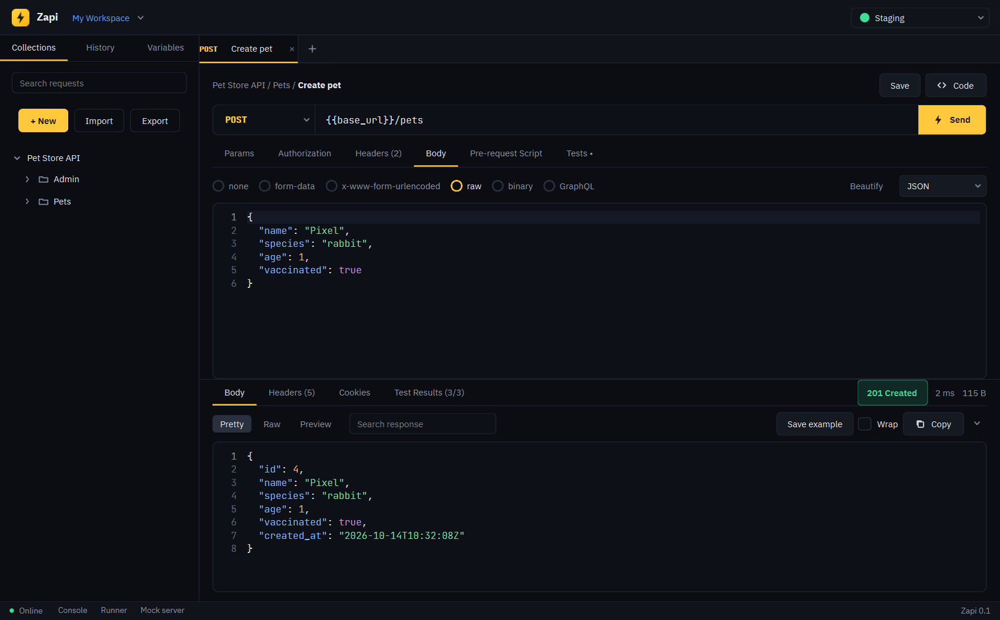

# Zapi

A fast, local-first desktop API client (Python + PySide6). No account, no telemetry; everything is stored on your computer.



More: [tests](docs/screenshots/02-tests-dark.png) · [scripts](docs/screenshots/03-scripts-dark.png) · [runner](docs/screenshots/06-runner.png) · [mock server](docs/screenshots/07-mock-server.png) · [WebSocket](docs/screenshots/08-websocket.png) · [light theme](docs/screenshots/01-request-light.png) · [midnight](docs/screenshots/01-request-midnight.png)

## Run
```
pip install -r requirements.txt
python main.py                                 # the app
python main.py --selftest                      # exercises every bundled component
python main.py run collection.json -e env.json # command line runner (zapi-cli.exe in the installed build)
python -m unittest discover -s tests -t .
```

## What it does
| Area | Features |
|---|---|
| **HTTP** | GET, POST, PUT, PATCH, DELETE, HEAD, OPTIONS; params, headers (with **Bulk Edit** as text); hover `{{variables}}` to see values and type `{{` for autocomplete; bodies: form-data, x-www-form-urlencoded, raw JSON / XML / text / HTML / JavaScript, binary, GraphQL, SOAP 1.1 / 1.2; redirects, SSL-verify and timeout settings; cookie jar |
| **Auth** | API key, Bearer, Basic, Digest, OAuth 1.0 (HMAC-SHA1 / SHA256 / PLAINTEXT), OAuth 2.0 (client credentials, password, authorization code + PKCE, refresh), AWS Signature v4, Hawk, NTLMv2 |
| **Response** | Pretty / Raw / Preview (HTML, images), filter JSON by path (`$.items[?(@.price < 10)].name`), search, wrap, status, time, size, headers, cookies, test results, "Save as example"; **Copy** the body, headers, status line, whole response, the request as cURL or its URL; save the body to a file; copy table rows with Ctrl+C or right-click |
| **Other protocols** | WebSocket, Server-Sent Events, MQTT 3.1.1 (QoS 0-2), gRPC (through server reflection: unary, server / client / bidirectional streaming), SOAP |
| **Network** | Proxy (system / none / custom), client certificate, custom CA bundle, redirects, SSL verify, timeout; cookie manager |
| **Organise** | Collections with nested folders (drag and drop to move), tabs that restore on restart, history, search |
| **Security** | Your whole workspace file (collections, requests, environments, history, settings) is compressed and encrypted on disk with Windows DPAPI, tied to your Windows account, and credentials are encrypted a second time inside it: variables marked Secret or named like one, every auth field, hand-typed `Authorization` / `Cookie` / `X-API-Key` headers and `token` / `password` params and form fields, URLs with `?token=` or `user:pass@`, and scripts or bodies that contain a hard-coded credential. Shared exports leave credentials out. Full backups are protected with a passphrase (scrypt, authenticated) so they can move between computers |
| **Inheritance** | Set authorization, headers and pre-request / test scripts once on a collection or folder (right-click, Settings); requests use *Inherit auth from parent* by default, a request can override, a folder overrides its collection, and the Authorization / Headers / Script tabs show what is inherited. Postman collection- and folder-level auth and scripts import and export as such |
| **Variables** | `{{name}}` everywhere; Globals, collection and environment scopes; Initial vs Current values; secrets masked and never exported; dynamic `{{$guid}}`, `{{$timestamp}}`, `{{$isoTimestamp}}`, `{{$randomInt}}` |
| **Scripts** | JavaScript pre-request and test scripts with a `pm` API (`pm.test`, `pm.expect`, `pm.response`, `pm.request`, `pm.environment / globals / collectionVariables / variables`, `pm.iterationData`, `postman.setNextRequest`, `CryptoJS` hashes / HMAC, `console`). Runs in a helper process with a 10 s limit |
| **Runner** | Run a collection or folder with iterations, CSV / JSON data files, delay, stop-on-failure; export JSON / JUnit |
| **Quick find** | Command palette (`Ctrl+K`): jump to any request, switch environment, open history or run a command by typing a few letters |
| **Developer tools** | JWT decoder (with HS256 / 384 / 512 signature check and expiry), Base64, URL encoding, hashes / HMAC, epoch time converter and UUID generator; right-click a selection in a response to decode it |
| **Load test** | Postman-style performance testing: run a collection or folder with up to 500 virtual users using a Fixed, Ramp up or Spike profile, with think time and an optional data file; live requests / second, average, 95th percentile, errors and a response-time chart, per-request table, export JSON / CSV |
| **CLI** | `zapi-cli run` (Newman-style): environments, globals, data files, `--bail`, `--folder`, reporters `cli`, `json`, `junit`; exit code 0 / 1 / 2 for CI. `zapi-cli load` runs a load test with `--vus`, `--duration`, `--profile` and pass / fail thresholds (`--max-error-rate`, `--max-p95`) |
| **Mock server** | Local routes with path parameters, templated bodies (`{{params.id}}`, `{{query.x}}`, `{{body}}`), delays, CORS; routes can be generated from a collection and its saved examples |
| **Import** | Paste cURL (bash / Windows cmd), `fetch()` or a file's text into any URL box; import Postman collections (folders, scripts, examples, all auth types) and environments, OpenAPI 3 / Swagger JSON (YAML with PyYAML), Zapi files |
| **Export** | Per collection as Zapi JSON or Postman v2.1; all collections; environments and globals (initial values, no secrets); history; mock routes; the open request; and a **full workspace backup** (collections, environments with current values and secrets, globals, history, mock routes, settings) that restores with Merge or Replace |
| **Code generation** | cURL, Python (requests), JavaScript (fetch), Node.js (axios), PowerShell, Java, C#, Go, PHP, Ruby |

Right-click tabs (close others, duplicate, copy URL / cURL), requests and history entries (copy URL / cURL). `F1` opens the shortcut and scripting reference.

Shortcuts: `Ctrl+Shift+C` copy request as cURL, `Ctrl+N` new request, `Ctrl+Enter` send / connect, `Ctrl+S` save, `Ctrl+W` close tab, `Ctrl+L` focus URL, `Ctrl+Shift+E` environments, ``Ctrl+` `` console.

Not included: anything that needs a hosted service (team workspaces, sync, comments, roles, published docs, API Network, cloud monitors).
`pm.sendRequest()` and `require()` of npm modules (only `crypto-js`) are not available in scripts.

## Build the installer
`build.bat` generates the icon and installer artwork (`tools/make_assets.py`), builds `dist\Zapi\` with PyInstaller (`Zapi.spec`: `Zapi.exe`
plus the console `zapi-cli.exe`), trims unused Qt parts, runs the packaged `--selftest`, and compiles `installer.iss` with Inno Setup into
`dist\Zapi-Setup.exe`. The installer can add `zapi-cli` to your PATH.

`make_portable.bat` builds the portable edition as **one file**, `dist\Zapi-Portable.exe` (`ZapiPortable.spec`): copy it anywhere and
run it, with no installer, no admin rights and no registry entries. It keeps your workspace, logs and caches in a `ZapiData` folder next to
the exe. A one-file exe unpacks itself to a temporary folder at every start (about two seconds) and removes it on exit. The script
verifies the real file with the packaged self-test and checks where it stores its data. The workspace is encrypted per Windows user, so
the `ZapiData` folder does not open on another PC or account (Zapi keeps a copy of the file and tells you; use an encrypted passphrase
export to move your data). The console runner `zapi-cli.exe` is part of the installer build only.

The installer wizard uses Lavati Softwares branding; the app and its icon use Zapi's own amber bolt.

Data lives in `%APPDATA%\Zapi\workspace.json` (override with the `ZAPI_HOME` environment variable).
