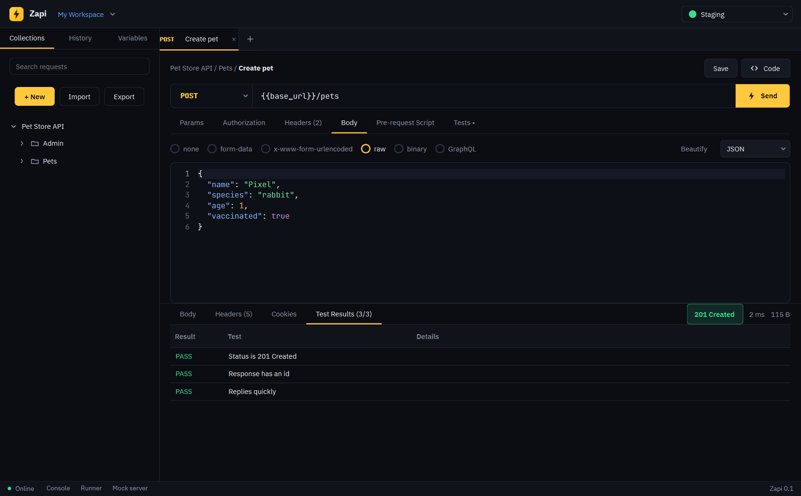
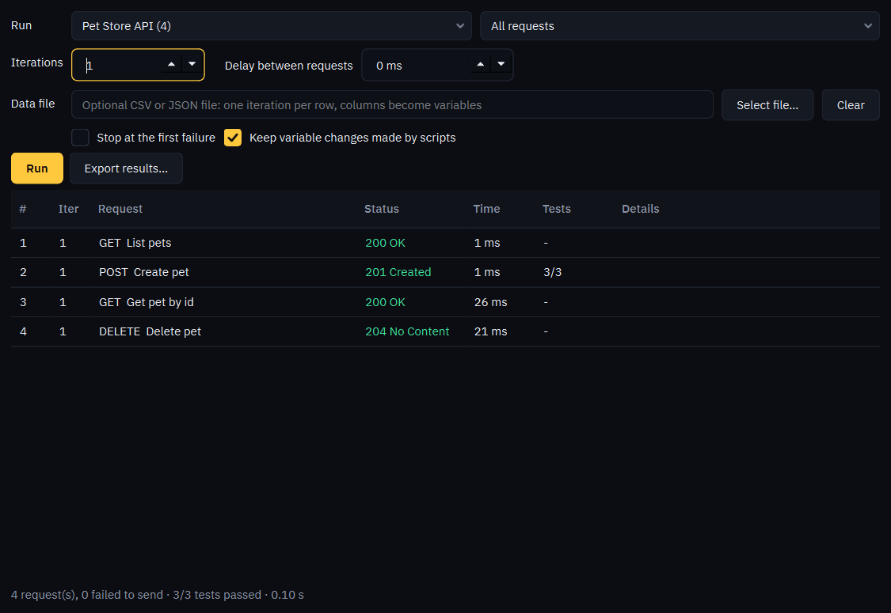
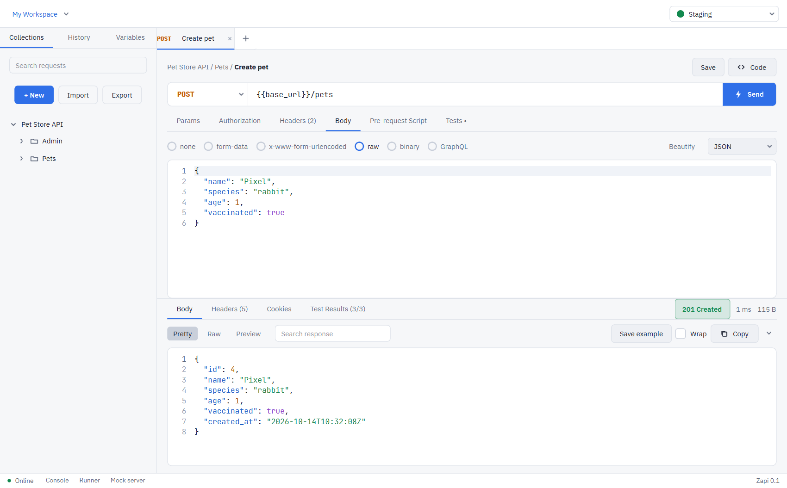
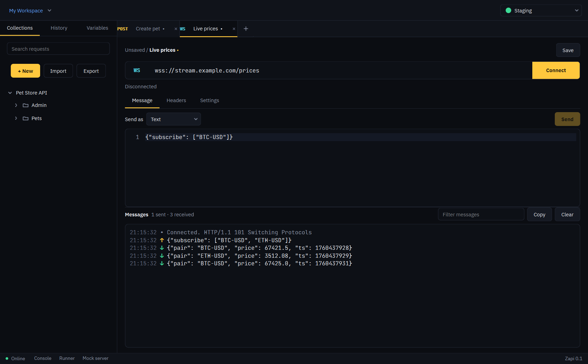

# Zapi 0.1 preview

**A fast, private API client for Windows.** Build and send requests, organise them in collections, switch environments, write
tests, and run it all from the command line. Everything stays on your computer: no account, no telemetry, no cloud.

> **This is a preview.** It is feature-rich but young. Please try it on real work, **keep your own backups** (Export → Full
> workspace backup), and tell us what breaks. The installer is **not code-signed yet**, so Windows will say "Unknown
> publisher": click *More info → Run anyway*. The SHA-256 of the installer is in the release page.

## What you can do
- **Send requests**: GET, POST, PUT, PATCH, DELETE, HEAD, OPTIONS; query params, headers, JSON / XML / form / binary /
  GraphQL / SOAP bodies. Paste a **cURL command, a `fetch()` call, or a Postman / OpenAPI file** into the URL bar and it imports.
- **Authenticate**: API key, Bearer, Basic, Digest, OAuth 1.0, OAuth 2.0 (including browser login), AWS Signature v4, Hawk, NTLM.
- **Organise**: collections with folders (drag and drop), environments with initial and current values, history, search.
- **Test**: JavaScript pre-request and test scripts with a Postman-style `pm` API, a Collection Runner with CSV / JSON data
  files, and `zapi-cli` to run collections in CI with JUnit / JSON reports.
- **Beyond HTTP**: WebSocket, Server-Sent Events, MQTT, gRPC (through server reflection), a built-in **mock server**.
- **Share safely**: export collections as Zapi JSON or Postman v2.1 (credentials are left out), and back everything up
  with a passphrase-protected file.
- **Make it yours**: Dark, Light, Midnight and High-contrast themes, accent colours, proxy and client-certificate settings.

| | |
|---|---|
|  |  |
|  |  |

## Your data and privacy
- Zapi talks only to the addresses you enter. No telemetry, no accounts, no update pings.
- Your whole workspace is **compressed and encrypted on disk with Windows (DPAPI)**, and credentials are encrypted again inside it:
  it opens only for your Windows user on this computer. See `SECURITY.md` for exactly what is and is not protected.
- Crash reports are written to `%APPDATA%\Zapi\logs` and are never sent. You choose whether to attach one to a bug report.

## Known limitations
- Windows 10/11 only; the installer is x64 and unsigned. No auto-update yet: download the new installer to update
  (your data is kept).
- gRPC needs a server with reflection enabled (no `.proto` file loading yet).
- Scripts: no `pm.sendRequest()`; `require()` supports only `crypto-js`. Scripts run with the app's access, so only run
  scripts you trust.
- No team features, sync or cloud workspaces, by design.
- WebSocket, MQTT, gRPC, NTLM and OAuth are tested against local test servers; real-world servers may surface differences.
  This is exactly where we need your reports.

## Installing
1. Download `Zapi-Setup.exe` and (optionally) check its SHA-256.
2. Run it. No administrator rights are needed. Tick *Add zapi-cli to the PATH* if you want the command line.
3. Start Zapi from the Start menu. Press **F1** for shortcuts and the scripting reference.

To update, run the newer installer: it closes Zapi, replaces the files, and keeps your collections, settings and PATH choice. It
refuses to replace a newer version with an older one by accident.

To remove it: Settings → Apps → Zapi → Uninstall. You are asked whether to keep your collections and settings; **keeping them is
the default**. For silent uninstalls, `/REMOVEDATA` deletes them.

## Reporting problems
Open an issue and fill in the template. In Zapi use **My Workspace menu → Copy diagnostic info** and paste it in. It contains
the version, Windows version and a few settings, never your requests or secrets. Please remove anything private from
screenshots and logs.
